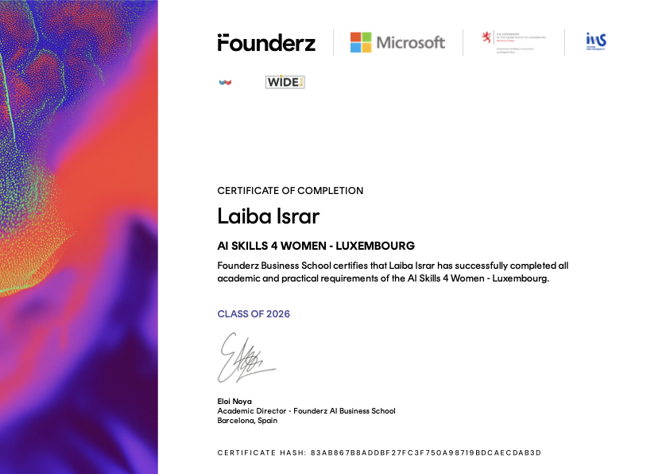

# 💜 Hi, I'm Laibaa! ♡

### 🎀 Software Engineer Student | Aspiring Software Developer

*Turning ideas into code, one project at a time ✨*

---

## 🌷 About Me

- 🎓 I'm a university student passionate about technology.
- 🐍 I have learned Python programming.
- ☕ I have learned Java and Object-Oriented Programming.
- 🌐 I have learned HTML and CSS for web development.
- 🌳 I have studied Data Structures and Algorithms.
- 💻 I enjoy building projects and improving my coding skills.
- ✨ Always curious, always learning!

---

## 🎀 Languages & Technologies

---

## 💗 My Projects

### 🎮 Hangman Game
A fun word-guessing game project.

🔗 [View Repository](https://github.com/laiibakhan/hangman-game)

---

### ⌚ Watch
A project related to a watch.

🔗 [View Repository](https://github.com/laiibakhan/watch)

---

### 🛡️ Cyber Threat Management System
A project focused on cyber threat management.

🔗 [View Repository](https://github.com/laiibakhan/Cyber-Threat-Management-System)

---

### 🏥 Hospital Management System — MediCareHub

A Java-based Hospital Management System designed to manage hospital operations through a desktop application.

**Technologies:** Java · Java Swing

**Features:**
- Patient management
- Doctor management
- Appointment management
- Billing management

🔗 [View MediCareHub Repository](https://github.com/laiibakhan/MediCareHub)

---

### 💜 My GitHub Profile
Explore my other repositories and coding projects.

🔗 [View All Repositories](https://github.com/laiibakhan?tab=repositories)

### 🐍 Python Projects
Python programs, coding exercises, and problem-solving practice.

🔗 [Explore My Python Projects](https://github.com/YOUR_USERNAME?tab=repositories)

### ☕ Java Projects
Object-oriented programming, classes, inheritance, and Java applications.

🔗 [Explore My Java Projects](https://github.com/YOUR_USERNAME?tab=repositories)

### 🌐 Web Development
Web pages and designs created using HTML and CSS.

🔗 [Explore My Web Projects](https://github.com/YOUR_USERNAME?tab=repositories)

### 🌳 Data Structures & Algorithms
Implementations of trees, graphs, sorting, searching, and other algorithms.

🔗 [Explore My Data Structures Projects](https://github.com/YOUR_USERNAME?tab=repositories)

---

---

## 🏆 Certificates & Achievements

### 💜 AI Skills 4 Women — Luxembourg

*Founderz Business School · Class of 2026*

Proud to have completed the AI Skills 4 Women program, gaining academic and practical experience in AI skills.

**✨ Always learning, always growing! ✨**

---

## 🌸 My Goals

- [ ] Build more real-world projects.
- [ ] Improve my problem-solving skills.
- [ ] Create attractive and responsive websites.
- [ ] Explore new programming technologies.
- [ ] Keep growing as a developer. 💜

---

## 💌 Thanks for Visiting!

I'm passionate about learning, creating, and turning ideas into working projects.

*Made with 💜, ☕ and a little bit of pink.*

